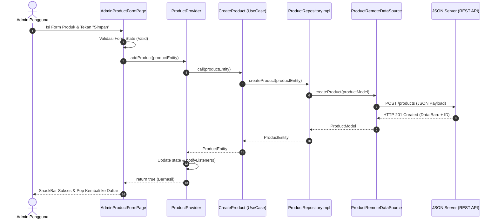

# Dokumentasi Proyek Aplikasi Foodie

<!--
============================================================================
TUGAS: Anggota 5 - Membuat Dokumentasi Aplikasi, Diagram & Panduan
FASE: Fase 8 - Dokumentasi dan Presentasi
============================================================================

1. APA FUNGSI FILE ATAU PERINTAH TERSEBUT:
   Menyediakan laporan dokumentasi teknis lengkap mengenai aplikasi Foodie:
   tujuan, fitur-fitur utama, arsitektur Clean Architecture, diagram alur,
   serta pemetaan kebutuhan (requirements).

2. MENGAPA KITA MEMBUTUHKANNYA:
   Sebagai referensi teknis komprehensif bagi dosen, penguji, dan anggota tim
   untuk memahami implementasi arsitektur perangkat lunak dan alur data.

3. BAGAIMANA HUBUNGANNYA DENGAN CLEAN ARCHITECTURE:
   Menjelaskan struktur 3 lapis (Presentation, Domain, Data) dan Core cross-cutting.

4. KODE LENGKAP YANG PERLU KAMU MASUKKAN:
   (Laporan dokumentasi teknis di bawah ini)

5. CARA MENJALANKAN DAN MENGUJINYA:
   Buka file ini di Markdown Preview (VS Code / Android Studio).

6. HASIL YANG SEHARUSNYA MUNCUL:
   Dokumen terstruktur dengan diagram Mermaid dan tabel pemetaan fitur.
============================================================================
-->

## 1. Tujuan dan Gambaran Aplikasi
**Foodie** adalah aplikasi pemesanan kuliner berbasis mobile (Flutter & Android) yang dirancang dengan standar industri perangkat lunak. Aplikasi ini menghubungkan antarmuka pengguna interaktif dengan REST API (JSON Server) melalui arsitektur bersih (**Clean Architecture**) dan state management **Provider**.

Tujuan utama pembuatan aplikasi:
1. Memberikan kemudahan bagi pengguna dalam memilih menu makanan, melihat detail produk, mengelola keranjang belanja, dan memesan makanan.
2. Menyediakan panel admin untuk pengelolaan menu secara penuh melalui operasi **CRUD** (Create, Read, Update, Delete) nyata ke backend REST API.
3. Menerapkan pola arsitektur **Clean Architecture** yang modular, terpisah antar lapisan, dan mudah diuji (*testable*).

---

## 2. Pemetaan Fitur Terhadap Requirement

| Requirement | Implementasi Foodie | Keterangan |
|---|---|---|
| **Dashboard** | Home / Menu | Menampilkan katalog makanan, filter kategori, search bar, dan promo banner. |
| **Navigasi** | Bottom Navigation | Berpindah antara Home, Keranjang, Pesanan, dan Admin secara mulus dengan `go_router`. |
| **Daftar Data** | Daftar Produk | Grid produk responsif dengan gambar, nama, kategori, rating, dan harga. |
| **Detail Data** | Detail Produk | Informasi porsi, stok, catatan pesanan khusus, dan tombol tambah kuantitas. |
| **Create** | Tambah Produk | Form tambah produk baru di panel Admin dengan validasi field. |
| **Read** | Daftar & Detail Produk | Mengambil data produk secara real-time dari JSON Server. |
| **Update** | Edit Produk | Form modifikasi harga, nama, stok, dan deskripsi produk di Admin. |
| **Delete** | Hapus Produk | Penghapusan produk dengan dialog konfirmasi keamanan modal. |
| **Validasi** | Form Tambah & Edit | Validasi input teks, nominal angka, URL, dan dropdown kategori. |
| **Loading State** | Indikator Pemuatan | Circular spinner oranye bertema Foodie saat request asynchronous. |
| **Empty State** | Pesan Data Kosong | Tampilan ilustrasi dan panduan ramah saat menu / keranjang kosong. |
| **Success State** | Notifikasi Berhasil | Floating SnackBar hijau saat aksi keranjang/CRUD sukses. |
| **Error State** | Pesan Gagal & Retry | Kartu informasi error jaringan disertai tombol "Coba Lagi". |
| **CRUD Nyata** | JSON Server + `db.json` | Mock REST API independen dengan persistence file JSON. |

---

## 3. Diagram Clean Architecture

Aplikasi Foodie menerapkan arsitektur Clean Architecture yang memisahkan tanggung jawab kode ke dalam tiga layer utama:

```mermaid
graph TD
    subgraph UI ["Presentation Layer (Flutter)"]
        Pages["Pages (Home, Detail, Cart, Orders, Admin)"]
        Widgets["Reusable Widgets (ProductCard, ChipList, States)"]
        Providers["Providers (ProductProvider, CartProvider, OrderProvider)"]
    end

    subgraph Core ["Core Layer"]
        Network["ApiClient (Dio)"]
        Errors["Exceptions & Failures"]
        Utils["Formatters & Constants"]
        Theme["AppTheme"]
    end

    subgraph Domain ["Domain Layer (Business Logic)"]
        Entities["Entities (ProductEntity)"]
        UseCases["Use Cases (GetProducts, CreateProduct, UpdateProduct, DeleteProduct)"]
        RepoContract["Repository Contract (ProductRepository)"]
    end

    subgraph Data ["Data Layer (Infrastructure)"]
        Models["Models (ProductModel with JSON)"]
        Datasources["Remote Datasource (ProductRemoteDataSource)"]
        RepoImpl["Repository Implementation (ProductRepositoryImpl)"]
    end

    subgraph Backend ["External API"]
        JSONServer["JSON Server (db.json REST API :3000)"]
    end

    Pages --> Providers
    Providers --> UseCases
    UseCases --> RepoContract
    RepoImpl ..|> RepoContract
    RepoImpl --> Datasources
    Datasources --> Network
    Network --> JSONServer
    Datasources --> Models
    Models -- Extends --> Entities
```

### Penjelasan Setiap Layer:
1. **Domain Layer (Lapisan Terluar dari Framework, Terdalam secara Logika)**:
   - **Entities**: Objek data bisnis murni (`ProductEntity`). Tidak terikat library eksternal.
   - **Repository Contract**: Interface abstrak (`ProductRepository`) yang menentukan fungsi apa saja yang harus tersedia.
   - **Use Cases**: Satu aksi bisnis per class (misal: `GetProducts`, `CreateProduct`, `DeleteProduct`).
2. **Data Layer (Infrastruktur Data)**:
   - **Models**: Implementasi entity yang memiliki kemampuan parse JSON (`ProductModel`).
   - **Datasources**: Penghubung langsung ke endpoint HTTP menggunakan `ApiClient`.
   - **Repository Implementation**: Mengimplementasikan kontrak domain, mengubah Exception menjadi Failure.
3. **Presentation Layer (Tampilan & Interaksi Pengguna)**:
   - **Providers**: State management reaktif (`ChangeNotifier`).
   - **Pages & Widgets**: Komponen visual UI Flutter.
4. **Core Layer (Fondasi Bersama)**:
   - Menyediakan penanganan Exception, Failure, Formatting mata uang rupiah, Base URL, dan Tema warna.

---

## 4. Diagram Alur Transaksi CRUD Produk



---

## 5. Pembagian Tanggung Jawab Anggota Tim

- **Anggota 1**: Setup project Flutter, struktur direktori Clean Architecture, dependency pubspec, integrasi seluruh modul, dan penyiapan runtime Android.
- **Anggota 2**: Desain UI modern Foodie, halaman Home, Detail Produk, Cart, Orders, reusable widgets, dan sistem navigasi Bottom Navigation.
- **Anggota 3**: Alur proses CRUD produk di sisi aplikasi, pembuatan form validasi tambah & edit, dialog konfirmasi penghapusan produk, dan integrasi interaksi keranjang/checkout.
- **Anggota 4**: Desain skema data `db.json`, setup JSON Server REST API, implementasi Entity, Repository Contract, Use Cases, Data Model, Datasource, dan Repository Implementation.
- **Anggota 5**: Penyusunan dokumentasi teknis, pembuatan diagram Clean Architecture & Sequence, slide presentasi tim, dan skenario demonstrasi aplikasi.
