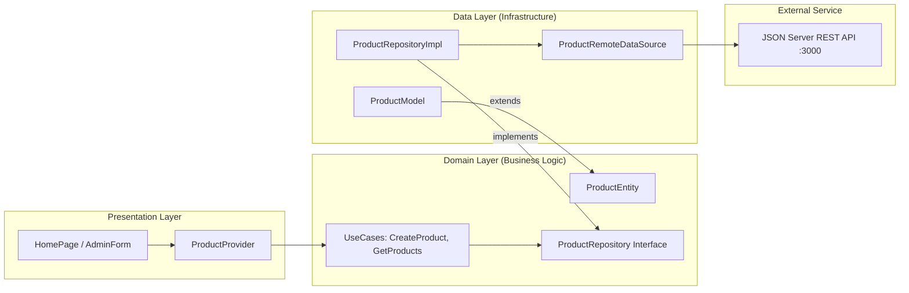

# Panduan Lengkap Jawaban Evaluasi & Ujian Proyek Aplikasi Foodie

Dokumen ini disusun secara sistematis berdasarkan butir-butir evaluasi proyek aplikasi **Foodie (Pemesanan Makanan Mobile Berbasis Flutter & Clean Architecture)**. File ini dapat langsung digunakan sebagai bahan ujian, naskah presentasi, laporan resmi, dan panduan menjawab pertanyaan dosen/penguji.

---

## DAFTAR ISI
1. [Butir 1: Masalah, Tujuan, Pengguna Sasaran, dan Fitur Aplikasi](#1-masalah-tujuan-pengguna-sasaran-dan-fitur-aplikasi)
2. [Butir 2: Struktur Folder dan Alasan Penggunaan Clean Architecture](#2-struktur-folder-dan-alasan-penggunaan-clean-architecture)
3. [Butir 3: Hubungan Presentation, Domain, dan Data pada Kode Nyata](#3-hubungan-presentation-domain-dan-data-pada-kode-nyata)
4. [Butir 4: Panduan Demonstrasi Fitur Utama dan CRUD Secara Langsung](#4-panduan-demonstrasi-fitur-utama-dan-crud-secara-langsung)
5. [Butir 5: Sumber Data, Penanganan Error, dan Hasil Pengujian](#5-sumber-data-penanganan-error-dan-hasil-pengujian)
6. [Butir 6: Pembagian Kontribusi Individual dan Bank Tanya Jawab Dosen](#6-pembagian-kontribusi-individual-dan-bank-tanya-jawab-dosen)

---

## 1. Masalah, Tujuan, Pengguna Sasaran, dan Fitur Aplikasi

### A. Latar Belakang & Masalah (Problem Statement)
1. **Inefisiensi Pemesanan Konvensional**: Proses pemesanan makanan secara fisik sering menimbulkan antrean panjang di kasir, kesalahan pencatatan pesanan (human error), dan ketidakjelasan status ketersediaan menu secara *real-time*.
2. **Katalog Menu yang Tidak Dinamis**: Pelanggan sering memesan menu yang ternyata sudah habis karena menu fisik tidak diperbarui secara instan oleh pihak pengelola.
3. **Kelemahan Arsitektur Kode Tradisional**: Banyak pengembang pemula mencampurkan logika bisnis, panggilan HTTP, dan kode UI ke dalam satu widget (*spaghetti code*). Hal ini membuat aplikasi rentan bug, sulit diuji (*untestable*), dan sulit dikembangkan bersama dalam tim.

### B. Tujuan Proyek (Project Objectives)
1. Membangun aplikasi pemesanan makanan mobile berbasis **Flutter** dan **Android** yang memiliki antarmuka modern, responsif, dan estetik bertema hijau segar (*fresh green*).
2. Mengintegrasikan aplikasi dengan simulasi backend **REST API (JSON Server)** untuk menyajikan fungsionalitas transaksi nyata (katalog produk, keranjang belanja, checkout transaksi, dan panel admin).
3. Menerapkan standar rekayasa perangkat lunak industri dengan pola **Clean Architecture** (Uncle Bob) dan state management **Provider** untuk menjamin kode yang modular, terpisah antar layer, dan mudah dirawat (*maintainable*).

### C. Pengguna Sasaran (Target Audience)
Aplikasi Foodie dirancang untuk dua persona pengguna utama:
1. **Pelanggan (Customer / Food Enthusiast)**:
   - Pengguna smartphone yang ingin memesan makanan/minuman dengan cepat, melihat visual menu lezat, membaca ulasan rating, menambahkan catatan pesanan khusus, dan mengelola keranjang belanja hingga proses checkout.
2. **Pengelola Restoran / Admin Kuliner**:
   - Pengelola operasional makanan yang membutuhkan hak akses untuk mengelola katalog produk (menambah menu baru, memperbarui harga/stok, mengunggah foto produk langsung dari kamera/galeri, serta menghapus menu yang sudah tidak dijual).

### D. Fitur-Fitur Utama Aplikasi
| Kategori | Fitur Utama | Deskripsi Teknis & Fungsional |
|---|---|---|
| **Katalog & Beranda** | **Pencarian Real-Time** | Kolom pencarian responsif untuk mencari makanan berdasarkan nama secara instan. |
| | **Filter Kategori** | Filter chip kategori (*Makanan Utama, Minuman, Camilan, Dessert*). |
| | **Banner Promo Dinamis** | Tampilan promosi potongan harga dengan gradien hijau segar. |
| | **Katalog Menu Grid** | Tampilan kartu menu lengkap dengan rating bintang, kategori, harga Rupiah, dan tombol tambah cepat. |
| **Detail Produk** | **Informasi Menu Mendalam** | Foto resolusi tinggi, deskripsi bahan, ketersediaan stok porsi, dan rating. |
| | **Catatan Khusus (Notes)** | Input opsional preferensi pesanan (misal: *"Kurangi pedas, kuah dipisah"*). |
| | **Stepper Kuantitas** | Pengatur jumlah pesanan (+/-) dengan validasi batas stok maksimum. |
| **Keranjang Belanja** | **Manajemen Item** | Mengubah kuantitas item, kalkulasi subtotal dan total harga secara otomatis. |
| | **Hapus & Bersihkan** | Menghapus satu item atau mengosongkan seluruh keranjang belanja dengan dialog modal. |
| | **Alur Checkout** | Transaksi langsung yang menyimpan pesanan ke endpoint `/orders` dan mengosongkan keranjang. |
| **Riwayat Pesanan** | **Tracking Transaksi** | Daftar pesanan aktif dan riwayat belanja, status pengerjaan (*"Diproses"* / *"Selesai"*), dan detail pembayaran. |
| **Panel Admin (CRUD)** | **Create (Tambah Menu)** | Form penambahan produk baru dengan validasi data dan upload foto dari galeri/kamera atau URL. |
| | **Read (Katalog Admin)** | Tampilan daftar menu khusus pengelola dengan tombol aksi edit dan hapus. |
| | **Update (Ubah Data)** | Mengedit nama, harga, kategori, stok, dan deskripsi produk yang sudah ada di database. |
| | **Delete (Hapus Menu)** | Penghapusan produk dari database REST API disertai dialog konfirmasi keamanan modal. |
| **User Experience (UX)** | **4 States Lengkap** | Loading indicator, Empty state ilustratif, Error state dengan tombol *Retry*, dan Success SnackBar floating. |

---

## 2. Struktur Folder dan Alasan Penggunaan Clean Architecture

### A. Struktur Folder Proyek (Feature-First Clean Architecture)
Proyek Foodie diorganisasi menggunakan pendekatan **Feature-First** dipadukan dengan **Layered Clean Architecture**:

```text
foodie/
├── backend/                             # Mock REST API Server
│   ├── db.json                          # Database JSON (Products, Categories, Orders, Carts)
│   ├── package.json                     # Konfigurasi JSON Server (npm run dev pada port 3000)
│   └── README.md                        # Dokumentasi endpoint REST API
├── docs/                                # Dokumentasi Teknis & Presentasi
│   ├── dokumentasi_proyek.md            # Laporan teknis & diagram arsitektur Mermaid
│   ├── slide_presentasi.md              # Susunan materi slide presentasi
│   └── jawaban_evaluasi_proyek.md       # File panduan ujian ini
├── test/
│   └── widget_test.dart                 # Smoke test & Unit test format mata uang & entity
└── lib/
    ├── main.dart                        # Composition Root & Entry Point Aplikasi
    │
    ├── core/                            # Layer Cross-Cutting (Shared Components)
    │   ├── error/
    │   │   ├── exceptions.dart          # ServerException, NetworkException
    │   │   └── failures.dart            # ServerFailure, NetworkFailure
    │   ├── network/
    │   │   └── api_client.dart          # HTTP Client berbasis Dio dengan interceptor
    │   ├── theme/
    │   │   └── app_theme.dart           # Palet hijau segar & spesifikasi ThemeData Material 3
    │   ├── usecases/
    │   │   └── usecase.dart             # Kontrak abstrak UseCase<Type, Params>
    │   └── utils/
    │       ├── app_constants.dart       # Base URL dinamis (Android Emulator vs Web/Desktop)
    │       └── currency_formatter.dart  # Formatter Rupiah (IDR) & Tanggal Indonesia
    │
    └── features/                        # Fitur-Fitur Aplikasi
        ├── navigation/
        │   ├── app_router.dart          # Deklaratif routing dengan go_router
        │   └── main_navigation_scaffold.dart # Bottom Navigation Bar dengan realtime badge
        │
        ├── products/                    # Fitur Produk (Mengikuti Clean Architecture Lengkap)
        │   ├── domain/                  # 1. DOMAIN LAYER (Pure Business Logic)
        │   │   ├── entities/
        │   │   │   └── product_entity.dart
        │   │   ├── repositories/
        │   │   │   └── product_repository.dart  # Kontrak abstrak antarmuka
        │   │   └── usecases/
        │   │       ├── get_products.dart
        │   │       ├── get_product_by_id.dart
        │   │       ├── create_product.dart
        │   │       ├── update_product.dart
        │   │       └── delete_product.dart
        │   │
        │   ├── data/                    # 2. DATA LAYER (Infrastructure & External)
        │   │   ├── models/
        │   │   │   └── product_model.dart       # Serialisasi JSON (fromJson, toJson)
        │   │   ├── datasources/
        │   │   │   └── product_remote_data_source.dart # Panggilan HTTP Dio ke REST API
        │   │   └── repositories/
        │   │       └── product_repository_impl.dart    # Implementasi repository kontrak
        │   │
        │   └── presentation/            # 3. PRESENTATION LAYER (UI & State)
        │       ├── providers/
        │       │   └── product_provider.dart    # State management ChangeNotifier
        │       ├── pages/
        │       │   ├── home_page.dart
        │       │   ├── product_detail_page.dart
        │       │   ├── admin_product_list_page.dart
        │       │   └── admin_product_form_page.dart
        │       └── widgets/
        │           ├── product_card.dart
        │           ├── category_chip_list.dart
        │           ├── custom_image_view.dart
        │           ├── loading_widget.dart
        │           ├── empty_state_widget.dart
        │           └── error_state_widget.dart
        │
        ├── cart/                        # Fitur Keranjang Belanja
        │   ├── models/
        │   │   └── cart_item.dart
        │   └── presentation/
        │       ├── providers/
        │       │   └── cart_provider.dart
        │       └── pages/
        │           └── cart_page.dart
        │
        └── orders/                      # Fitur Pesanan & Checkout
            ├── models/
            │   └── order_model.dart
            └── presentation/
                ├── providers/
                │   └── order_provider.dart
                └── pages/
                    └── orders_page.dart
```

### B. Alasan Penggunaan Clean Architecture
1. **Separation of Concerns (Pemisahan Tanggung Jawab yang Jelas)**:
   - Logika bisnis (Domain), pengambilan data dari server (Data), dan antarmuka pengguna (Presentation) berada pada direktori dan kelas terpisah. Perubahan pada tampilan UI tidak akan merusak aturan bisnis.
2. **Independensi Framework & Database**:
   - Lapisan **Domain** sepenuhnya bebas dari dependency Flutter maupun Dio. Jika di kemudian hari backend diganti dari JSON Server ke Firebase atau GraphQL, lapisan Domain dan Presentation tidak perlu dirombak total.
3. **Kemudahan Pengujian (Testability)**:
   - Logika Use Case dapat diuji menggunakan *unit test* murni tanpa memerlukan emulator berjalan atau koneksi internet langsung (dapat menggunakan mock repository).
4. **Kolaborasi Tim Paralel (Scalability)**:
   - Anggota tim dapat bekerja bersamaan tanpa sering terjadi konflik git. Sebagai contoh: Anggota 2 mendesain UI widget sementara Anggota 4 menyusun Repository dan Data Source secara independen.

---

## 3. Hubungan Presentation, Domain, dan Data pada Kode Nyata

### A. Diagram Aturan Ketergantungan (Dependency Rule)
Aturan fundamental Clean Architecture menyatakan: **Ketergantungan hanya boleh mengarah ke dalam (ke arah Domain). Domain tidak boleh mengenal Data maupun Presentation.**



### B. Penelusuran Kode Nyata pada Alur Tambah Produk (Create Product Flow)

#### 1. Lapisan Domain (Pusat Logika Bisnis)
- **File**: `lib/features/products/domain/entities/product_entity.dart`
  Mendefinisikan blueprint produk murni tanpa atribut serialization JSON.
  ```dart
  class ProductEntity extends Equatable {
    final String id;
    final String name;
    final String description;
    final int price;
    final String categoryId;
    final String categoryName;
    final String imageUrl;
    final double rating;
    final int reviewCount;
    final int stock;
    final bool isAvailable;
    // ...
  }
  ```

- **File**: `lib/features/products/domain/repositories/product_repository.dart`
  Kontrak antarmuka (*interface contract*) abstrak yang mewajibkan method CRUD:
  ```dart
  abstract class ProductRepository {
    Future<List<ProductEntity>> getProducts({String? categoryId, String? search});
    Future<ProductEntity> getProductById(String id);
    Future<ProductEntity> createProduct(ProductEntity product);
    Future<ProductEntity> updateProduct(ProductEntity product);
    Future<bool> deleteProduct(String id);
  }
  ```

- **File**: `lib/features/products/domain/usecases/create_product.dart`
  Kelas usecase yang merepresentasikan satu aksi bisnis tunggal:
  ```dart
  class CreateProduct implements UseCase<ProductEntity, ProductEntity> {
    final ProductRepository repository;
    CreateProduct(this.repository);

    @override
    Future<ProductEntity> call(ProductEntity params) async {
      return await repository.createProduct(params);
    }
  }
  ```

#### 2. Lapisan Data (Infrastruktur & REST API)
- **File**: `lib/features/products/data/models/product_model.dart`
  Mewarisi `ProductEntity` dan menambahkan kemampuan mapping JSON (`fromJson` dan `toJson`):
  ```dart
  class ProductModel extends ProductEntity {
    const ProductModel({ ... }) : super( ... );

    factory ProductModel.fromJson(Map<String, dynamic> json) => ...;
    Map<String, dynamic> toJson() => ...;
    factory ProductModel.fromEntity(ProductEntity entity) => ...;
  }
  ```

- **File**: `lib/features/products/data/datasources/product_remote_data_source.dart`
  Melakukan komunikasi jaringan HTTP langsung menggunakan Dio:
  ```dart
  @override
  Future<ProductModel> createProduct(ProductModel product) async {
    try {
      final response = await apiClient.post(
        AppConstants.productsEndpoint,
        data: product.toJson(),
      );
      return ProductModel.fromJson(response.data as Map<String, dynamic>);
    } on DioException catch (e) {
      throw ServerException(message: e.message ?? 'Gagal membuat produk');
    }
  }
  ```

- **File**: `lib/features/products/data/repositories/product_repository_impl.dart`
  Mengimplementasikan kontrak `ProductRepository`, menjembatani RemoteDataSource dan mengonversi `ServerException` menjadi `Failure`:
  ```dart
  class ProductRepositoryImpl implements ProductRepository {
    final ProductRemoteDataSource remoteDataSource;
    ProductRepositoryImpl({required this.remoteDataSource});

    @override
    Future<ProductEntity> createProduct(ProductEntity product) async {
      try {
        final model = ProductModel.fromEntity(product);
        final result = await remoteDataSource.createProduct(model);
        return result;
      } on ServerException catch (e) {
        throw ServerFailure(e.message);
      }
    }
  }
  ```

#### 3. Lapisan Presentation (UI & State Management)
- **File**: `lib/features/products/presentation/providers/product_provider.dart`
  Mengelola state reaktif (`ChangeNotifier`) dan memanggil UseCase:
  ```dart
  Future<bool> addProduct(ProductEntity product) async {
    _isActionLoading = true;
    notifyListeners();
    try {
      final created = await createProductUseCase(product);
      _products.insert(0, created);
      _isActionLoading = false;
      notifyListeners();
      return true;
    } catch (e) {
      _errorMessage = e.toString();
      _isActionLoading = false;
      notifyListeners();
      return false;
    }
  }
  ```

- **File**: `lib/features/products/presentation/pages/admin_product_form_page.dart`
  Menerima input dari pengguna, memvalidasi form, dan memanggil provider:
  ```dart
  final success = await provider.addProduct(productToSave);
  if (success) {
    ScaffoldMessenger.of(context).showSnackBar(
      SnackBar(content: Text('Produk baru berhasil ditambahkan!')),
    );
    context.pop();
  }
  ```

#### 4. Titik Pertemuan (Composition Root) di `lib/main.dart`
Semua dependensi dihubungkan dari lapisan terdalam hingga terluar menggunakan **Dependency Injection**:
```dart
// 1. Core Network
final apiClient = ApiClient();

// 2. Data Layer
final productRemoteDataSource = ProductRemoteDataSourceImpl(apiClient: apiClient);
final productRepository = ProductRepositoryImpl(remoteDataSource: productRemoteDataSource);

// 3. Domain Layer (Use Cases)
final getProductsUseCase = GetProducts(productRepository);
final createProductUseCase = CreateProduct(productRepository);
// ...

// 4. Presentation Layer (Provider Injection)
ChangeNotifierProvider<ProductProvider>(
  create: (_) => ProductProvider(
    getProductsUseCase: getProductsUseCase,
    createProductUseCase: createProductUseCase,
    // ...
  ),
)
```

---

## 4. Panduan Demonstrasi Fitur Utama dan CRUD Secara Langsung

Gunakan skenario terstruktur berikut saat mempraktikkan aplikasi secara langsung di depan dosen:

```text
+-------------------------------------------------------------------------------+
|                       URUTAN DEMONSTRASI APLIKASI                             |
+-------------------------------------------------------------------------------+
| 1. Terminal      -> Jalankan JSON Server & Flutter Run                        |
| 2. Tab Home      -> Demo Pencarian, Filter Kategori, & Scroll Katalog         |
| 3. Tab Detail    -> Lihat Detail Menu, Tulis Catatan Khusus, Tambah Kuantitas |
| 4. Tab Keranjang -> Ubah Kuantitas, Cek Kalkulasi Harga, Lakukan Checkout     |
| 5. Tab Pesanan   -> Cek Riwayat Pesanan Masuk secara Real-Time                |
| 6. Tab Admin     -> Demonstrasi Lengkap Siklus CRUD (Create, Read, Update,    |
|                     Delete) Langsung Tersinkronisasi ke db.json               |
+-------------------------------------------------------------------------------+
```

### Langkah 1: Persiapan Eksekusi (Terminal)
1. Jalankan backend REST API:
   ```bash
   cd backend
   npm run dev
   ```
   *Tunjukkan ke dosen bahwa JSON Server aktif di `http://localhost:3000`*.
2. Jalankan aplikasi Flutter di terminal baru:
   ```bash
   flutter run
   ```

### Langkah 2: Demonstrasi Sisi Pelanggan (Customer Flow)
1. **Home / Katalog**:
   - Ketik *"Nasi"* di Search Bar -> Tunjukkan daftar makanan otomatis terfilter.
   - Ketuk chip kategori *"Minuman"* -> Tunjukkan hanya menu minuman yang muncul.
   - Ketuk kembali chip untuk reset filter kategori.
2. **Detail Produk**:
   - Ketuk kartu *"Nasi Goreng Spesial"*.
   - Tunjukkan transisi halaman yang mulus, rating bintang emas, dan ketersediaan sisa stok.
   - Pada kolom *Catatan Khusus*, ketik: *"Tolong jangan pakai daun bawang"*.
   - Naikkan kuantitas menjadi `2` porsi.
   - Tekan tombol **"Tambah Rp 56.000"** -> Muncul notifikasi floating SnackBar hijau.
3. **Keranjang Belanja (Cart)**:
   - Ketuk tab **Keranjang** pada Bottom Navigation (perhatikan badge angka bertambah).
   - Naikkan kuantitas dari `2` menjadi `3` -> Subtotal dan total pembayaran otomatis terhitung ulang secara instan.
   - Tekan tombol **"Checkout"**.
   - Muncul dialog modal konfirmasi sukses: *"Pesanan Berhasil Dibuat!"* beserta nomor pesanan acak.
4. **Riwayat Pesanan (Orders)**:
   - Buka tab **Pesanan** -> Tunjukkan pesanan baru yang baru saja di-checkout sudah tercatat dengan status *"Diproses"*.

### Langkah 3: Demonstrasi CRUD Lengkap Sisi Admin (Admin CRUD Flow)
Buka tab **Admin** di Bottom Navigation Bar untuk membuktikan bahwa aplikasi terhubung ke database nyata:

1. **READ**:
   - Tunjukkan daftar produk yang termuat dari backend `backend/db.json`.
2. **CREATE (Tambah Menu Baru)**:
   - Tekan Floating Action Button **"+ Tambah Produk"**.
   - Masukkan Data Uji:
     - Nama: `Ayam Geprek Sambal Korek`
     - Kategori: `Makanan Utama`
     - Harga: `22000`
     - Stok: `25`
     - Sumber Gambar: Gunakan tombol **"Upload Foto dari Perangkat"** (pilih file dari galeri) atau masukkan URL gambar makanan.
     - Deskripsi: `Ayam goreng renyah dengan ulekan cabai rawit pedas nikmat.`
   - Tekan **"Tambah Produk ke Menu"**.
   - Muncul SnackBar hijau sukses. Tunjukkan ke dosen bahwa produk baru langsung muncul di daftar Admin, halaman Home pelanggan, dan tercatat di file `backend/db.json`.
3. **UPDATE (Edit Produk)**:
   - Cari produk `Ayam Geprek Sambal Korek` yang baru saja dibuat, lalu tekan ikon pensil **Edit**.
   - Ubah Harga dari `22000` menjadi `25000` dan ubah stok menjadi `30`.
   - Tekan **"Simpan Perubahan"**.
   - Tunjukkan bahwa data harga di UI langsung terupdate menjadi `Rp 25.000`.
4. **DELETE (Hapus Produk)**:
   - Tekan ikon tong sampah merah pada produk tersebut.
   - Tunjukkan adanya **Dialog Konfirmasi Modal Pengaman**: *"Apakah kamu yakin ingin menghapus produk ini?"* (fitur pencegah klik tidak sengaja).
   - Tekan **"Hapus Sekarang"**.
   - Produk terhapus secara permanen dari UI dan dari `backend/db.json`.

---

## 5. Sumber Data, Penanganan Error, dan Hasil Pengujian

### A. Sumber Data (Data Source & Persistence)
- **Teknologi**: `json-server` berbasis Node.js yang bertindak sebagai mock REST API server mandiri.
- **File Database**: `backend/db.json` menyimpan tabel data terstruktur:
  - `products`: Koleksi makanan/minuman dengan atribut id, name, description, price, categoryId, categoryName, imageUrl, rating, reviewCount, stock, isAvailable.
  - `categories`: Daftar kategori makanan (cat-1 s.d cat-4).
  - `orders`: Log pesanan dan transaksi hasil checkout.
  - `carts`: Data keranjang belanja.
  - `users`: Profil akun pengguna simulasi.
- **Deteksi Base URL Otomatis**:
  Pada `lib/core/utils/app_constants.dart`, Base URL diatur dinamis:
  - Menggunakan `http://10.0.2.2:3000` ketika dijalankan di **Android Emulator** (alias IP loopback mesin host).
  - Menggunakan `http://localhost:3000` ketika dijalankan di **Web**, **Windows**, atau **macOS**.

### B. Penanganan Error (Error Handling Mechanism)
Aplikasi Foodie menerapkan penanganan error berlapis (*graceful error handling*) di setiap tingkatan arsitektur:

1. **Lapisan Jaringan & Data**:
   - `ApiClient` menangkap kesalahan HTTP (Timeout, Bad Request 400, Not Found 404, Internal Server Error 500) dan membungkusnya menjadi `ServerException(message)`.
2. **Lapisan Repository**:
   - Menangkap `ServerException` dan mengubahnya menjadi `ServerFailure(message)`. Hal ini mencegah aplikasi mengalami *crash* mendadak.
3. **Lapisan Validasi Form UI**:
   - Form Admin menggunakan `GlobalKey<FormState>` dengan aturan validasi ketat:
     - Nama & Deskripsi wajib diisi (deskripsi minimal 8 karakter).
     - Harga dan Stok harus berupa angka valid serta bernilai positif (> 0).
     - URL / Gambar wajib dipilih.
4. **Visualisasi State pada UI (4 User Experience States)**:
   - **Loading State**: Menampilkan `AppLoadingWidget` (Circular spinner bertema hijau) saat proses request asynchronous berlangsung.
   - **Empty State**: Menampilkan `EmptyStateWidget` jika katalog kosong, keranjang belanja kosong, atau pencarian tidak menghasilkan data.
   - **Error State**: Menampilkan `ErrorStateWidget` lengkap dengan ilustrasi jaringan, pesan ramah pengguna, dan tombol **"Coba Lagi" (Retry)** yang memicu pemanggilan ulang API.
   - **Success State**: Menampilkan SnackBar terapung (*floating*) dengan ikon centang sukses saat data berhasil ditambah/diubah/dihapus.

### C. Hasil Pengujian (Testing Results)
Kualitas dan stabilitas kode aplikasi Foodie dibuktikan melalui 2 parameter pengujian resmi Flutter:

1. **Static Code Analysis (`flutter analyze`)**:
   ```bash
   flutter analyze
   ```
   **Hasil**: `No issues found! (ran in 8.6s)` — 100% bersih dari error kompilasi, peringatan linting, maupun masalah sintaksis.
2. **Unit Testing & Smoke Testing (`flutter test`)**:
   - File pengujian: `test/widget_test.dart`.
   - Menguji kebenaran algoritma pemformatan nominal mata uang pada `CurrencyFormatter.formatRupiah(28000)` -> Memastikan menghasilkan format `Rp 28.000`.
   - Menguji konsistensi instansiasi objek data `ProductEntity` pada Domain Layer.
   ```bash
   flutter test
   ```
   **Hasil**:
   ```text
   00:00 +0: loading test/widget_test.dart
   00:00 +0: Smoke Test & Unit Test Foodie CurrencyFormatter format rupiah dengan benar
   00:00 +1: Smoke Test & Unit Test Foodie ProductEntity properti terisi dengan benar
   00:00 +2: All tests passed!
   ```

---

## 6. Pembagian Kontribusi Individual dan Bank Tanya Jawab Dosen

### A. Rincian Kontribusi Individual Anggota Tim

| Anggota Tim | Peran Utama | Rincian Tugas Spesifik yang Dikerjakan |
|---|---|---|
| **Anggota 1** | **Setup Project, Git & Integrasi** | • Menginisialisasi proyek Flutter dan konfigurasi `pubspec.yaml`.<br>• Menata arsitektur direktori Clean Architecture.<br>• Melakukan integrasi modul (`main.dart` Composition Root).<br>• Menulis dan memverifikasi unit test di `test/widget_test.dart`.<br>• Memastikan aplikasi *build & running* dengan lancar di platform Android. |
| **Anggota 2** | **Desain UI/UX & Halaman Customer** | • Mendesain sistem tema visual [AppTheme](file:///e:/ANDROID%20DEV%20JOURNEY/initial%20dev/foodie/lib/core/theme/app_theme.dart) dengan palet hijau segar modern.<br>• Membangun halaman pengguna: `HomePage`, `ProductDetailPage`, `CartPage`, dan `OrdersPage`.<br>• Membuat komponen reusable: `ProductCard`, `CategoryChipList`, dan navigasi `MainNavigationScaffold` (Bottom Navigation dengan badge realtime). |
| **Anggota 3** | **Alur Bisnis CRUD & Form Admin** | • Membangun halaman panel admin `AdminProductListPage`.<br>• Membuat formulir interaktif `AdminProductFormPage` lengkap dengan validasi field form.<br>• Mengimplementasikan fitur pemilihan gambar dari galeri perangkat/kamera (`image_picker`) dan konversi Base64.<br>• Menambahkan dialog modal konfirmasi keamanan penghapusan produk.<br>• Menghubungkan alur transaksi keranjang belanja dan checkout ke pesanan. |
| **Anggota 4** | **Backend REST API & Layer Domain/Data** | • Menyiapkan skema data `backend/db.json` dan skrip server JSON Server.<br>• Membangun **Domain Layer**: `ProductEntity`, `ProductRepository` contract, dan 5 Use Cases (`GetProducts`, `GetProductById`, `CreateProduct`, `UpdateProduct`, `DeleteProduct`).<br>• Membangun **Data Layer**: `ProductModel`, `ProductRemoteDataSource` (Dio), dan `ProductRepositoryImpl`.<br>• Mengatur konfigurasi base URL dinamis dan error handling network. |
| **Anggota 5** | **Dokumentasi, Diagram & Presentasi** | • Menyusun laporan teknis lengkap di `docs/dokumentasi_proyek.md`.<br>• Membuat diagram arsitektur sistem dan diagram sequence alur data (Mermaid).<br>• Menyusun slide presentasi resmi di `docs/slide_presentasi.md`.<br>• Menyusun naskah jawaban ujian dan skenario tanya jawab dosen di `docs/jawaban_evaluasi_proyek.md`. |

---

### B. Bank Tanya Jawab (Q&A) Dosen Populer & Rekomendasi Jawaban

#### Pertanyaan 1: *"Mengapa kalian menggunakan Clean Architecture? Bukankah untuk aplikasi pemesanan makanan sederhana ini arsitektur tersebut terlalu berlebihan (overkill)?"*
> **Jawaban Terbaik**:
> *"Penggunaan Clean Architecture pada proyek ini bertujuan untuk menerapkan standar rekayasa perangkat lunak industri (Software Engineering Best Practices). Meskipun scope aplikasi saat ini terlihat sederhana, Clean Architecture memberikan keuntungan besar dalam jangka panjang:*
> 1. *Kode memiliki **Separation of Concerns** yang kuat. Jika tim UI ingin merombak total tampilan antarmuka, mereka tidak akan mengganggu logika bisnis sama sekali.*
> 2. *Menjamin **Testability**: Logika bisnis pada Use Cases dan Entities dapat diuji secara independen tanpa bergantung pada emulator atau server backend.*
> 3. *Mempermudah pembagian kerja tim secara paralel tanpa terjadi conflict kode, di mana lapisan Domain, Data, dan UI dapat dikembangkan secara simultan."*

#### Pertanyaan 2: *"Apa perbedaan mendasar antara `ProductEntity` pada Domain Layer dan `ProductModel` pada Data Layer? Mengapa tidak digabung saja?"*
> **Jawaban Terbaik**:
> *"Pemisahan antara `ProductEntity` dan `ProductModel` merupakan prinsip inti Clean Architecture:*
> - *`ProductEntity` berada di **Domain Layer**, merepresentasikan objek bisnis murni. Entity tidak boleh mengetahui bagaimana data disimpan, tidak boleh bergantung pada library pihak ketiga, dan tidak memiliki method serialization JSON.*
> - *`ProductModel` berada di **Data Layer**, merupakan turunan (`extends`) dari `ProductEntity` yang memiliki tanggung jawab teknis infrastruktur, seperti parsing data dari JSON (`fromJson`) dan konversi ke JSON (`toJson`).*
> *Jika format API dari backend berubah (misal nama key berubah dari `price` menjadi `product_price`), kita hanya perlu mengubah `ProductModel` di Data Layer, sementara logika bisnis di Domain Layer tetap utuh dan aman."*

#### Pertanyaan 3: *"Bagaimana alur Dependency Inversion Principle (DIP) diterapkan antara Domain dan Data Layer pada kode kalian?"*
> **Jawaban Terbaik**:
> *"Dependency Inversion menyatakan bahwa modul tingkat tinggi tidak boleh bergantung pada modul tingkat rendah, keduanya harus bergantung pada abstraksi.*
> *Pada kode Foodie, Use Case (Domain) tidak langsung memanggil `ProductRepositoryImpl` (Data). Sebaliknya, Use Case hanya memanggil antarmuka abstrak `ProductRepository` yang juga didefinisikan di dalam Domain Layer.*
> *Implementasinya, yaitu `ProductRepositoryImpl`, berada di Data Layer dan mengimplementasikan kontrak tersebut. Hubungan keduanya kemudian dihubungkan di `lib/main.dart` melalui Dependency Injection."*

#### Pertanyaan 4: *"Mengapa memilih Provider sebagai state management dan bukan BLoC atau GetX?"*
> **Jawaban Terbaik**:
> *"Kami memilih `Provider` karena:*
> 1. *Direkomendasikan secara resmi oleh tim Google/Flutter untuk arsitektur aplikasi skala menengah.*
> 2. *Sintaksisnya bersih, menggunakan konsep dasar `ChangeNotifier` bawaan Flutter tanpa overhead boilerplate yang berlebihan seperti pada BLoC.*
> 3. *Berbeda dengan GetX yang cenderung mengabaikan kaidah Dependency Injection murni dan konteks widget tree, Provider bekerja secara alami selaras dengan lifecycle Flutter dan sangat mudah dipadukan dengan Clean Architecture."*

#### Pertanyaan 5: *"Bagaimana sistem menangani kondisi ketika server backend mati atau koneksi internet terputus saat pengguna menekan tombol Simpan?"*
> **Jawaban Terbaik**:
> *"Ketika request jaringan gagal, `ApiClient` (Dio) akan melempar `DioException`. Exception ini ditangkap oleh `ProductRemoteDataSource` dan diteruskan sebagai `ServerException`. Di `ProductRepositoryImpl`, exception tersebut ditangkap dan dikonversi menjadi `ServerFailure(message)`.*
> *Di tingkat UI, `ProductProvider` mencatat pesan kegagalan tersebut dan mengubah status `isActionLoading` menjadi `false`. Tampilan UI kemudian memunculkan SnackBar merah atau `ErrorStateWidget` yang ramah pengguna dilengkapi dengan tombol 'Coba Lagi' (Retry), sehingga aplikasi tidak mengalami force close / crash."*

#### Pertanyaan 6: *"Apakah operasi CRUD produk di aplikasi ini benar-benar tersimpan secara persisten atau hanya tersimpan di memory RAM sementara?"*
> **Jawaban Terbaik**:
> *"CRUD pada aplikasi Foodie tersimpan secara **persisten** di server database nyata (`backend/db.json`) melalui protokol HTTP REST API:*
> - *Saat menekan 'Tambah Produk', aplikasi mengirim HTTP POST ke `/products`, dan JSON Server langsung menulis record baru ke file `db.json`.*
> - *Saat menekan 'Edit', aplikasi mengirim HTTP PUT ke `/products/:id`.*
> - *Saat menekan 'Hapus', aplikasi mengirim HTTP DELETE ke `/products/:id`.*
> *Buktinya, jika aplikasi Flutter ditutup dan dibuka kembali, seluruh perubahan data produk tetap tersimpan dengan data terbaru dari `db.json`."*

---

*Dokumen ini disusun untuk memudahkan seluruh anggota tim Foodie dalam menghadapi sesi demonstrasi dan pengujian proyek. Sukses untuk presentasinya!*
